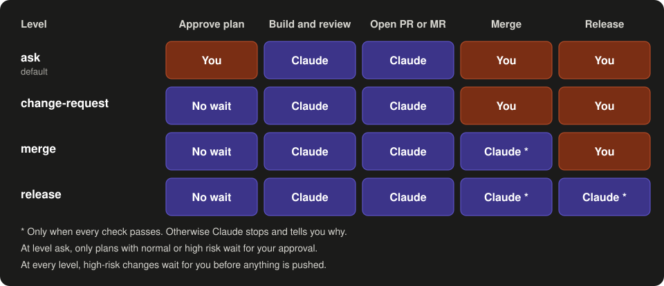

# prompt-to-ship

A pipeline for coding with Claude Code. A pipeline is a fixed series of steps that every change
goes through. You ask for a change in plain words. Claude turns it into a precise task and makes
a plan. Reviewer agents check the plan. An agent is a separate Claude instance with one
task and no access to your chat. Claude then builds the change and proves that it works. Other
agents review the result. At the end, Claude opens a pull request or merge request: a request to
add the change to the main code. You decide what gets merged and released.

**For whom:** developers who use Claude Code and want changes that are planned, tested and
reviewed before they reach the main code.

**Status:** a working prototype. The acceptance test in [TESTING.md](TESTING.md) is not complete
yet. The current version and its changes are in [CHANGELOG.md](CHANGELOG.md).

It works in any git repository and in any programming language. See [Code hosts](#code-hosts)
for GitHub, GitLab and others.

## How it works

<p align="center">
  
</p>

The diagram shows the default level, `ask`. At a higher level, some red "waits for you" boxes
go away. See [Autonomy](#autonomy).

## The steps

0. **Brief.** Claude reads the code and the documents first. Then it writes your request as a
   task of at most ten lines. The task gives the goal, the reason, the limits and the risk. It
   also says how to prove that the work is done. On high risk or an open question, Claude stops
   and asks you.
1. **Understand.** Claude reads the code that takes part, and the git history that explains it.
   Two agents can help, in this order. The **code search** agent looks in the code and in your
   own data sources; in a large code base it does the wide search. When the change needs a fact
   that is not there, such as a price, a tax rate or a legal rule, the **researcher** looks it
   up on the web. See [Outside facts](#outside-facts).
2. **Plan.** Claude chooses an approach and names its risks, in a fixed PLAN block. Reviewer
   agents check the plan at the same time. Each one gives a verdict: approve, or adjust with
   reasons.
   - The **architect** checks the structure, the data and whether the change can be undone.
   - The **UI specialist** checks what users will see and read. It runs only when the change is
     visible: a screen, an email, a document, a message or command-line output. For a new screen
     it first gives a short design brief.
   - The **product expert** checks whether the change fits the product, its users and its
     business rules.
3. **Build.** Claude works on its own branch. A branch is a separate copy of the code where work
   happens before it joins the main code. Claude writes a failing test first when it can.
4. **Prove.** Claude runs the build and the tests and shows the real output. A claim without
   output does not count.
5. **Review.** More checks, each by an agent that did not write the code:
   - The **fresh reviewer** sees only the change and the brief, and looks for bugs.
   - The **security reviewer** looks for real vulnerabilities, with evidence. It runs on normal
     and high risk.
   - A **validator** tries to disprove each serious finding. False alarms drop out this way.
   - The **product expert**, and on a visible change the **UI specialist**, check the result
     against the plan.

   Every finding gets an answer: fixed, or not fixed with a reason. After three rounds, Claude
   stops and asks you to rethink the approach.
6. **Pull or merge request.** The description always has three parts: what was tested, the risk,
   and how to revert the change.
7. **Merge and measure.** After the release, Claude checks that the goal from the brief is met.
8. **Learn.** When a mistake gets through, or a late review catches what an earlier step should
   have caught, Claude logs it. If the lesson is worth keeping, Claude puts it in the narrowest
   place: a test, a check command, or a rule for one step. You confirm each one. The weekly
   review shows which rules still catch problems and proposes to retire the rest. See
   [How it learns](#how-it-learns).

Each reviewer agent gets only the brief, the plan and the files. It never sees the chat. This
keeps its view fresh.

Once a week, the `weekly` command reviews the pull or merge requests of the last 7 days. It
only reads and changes nothing.

## Outside facts

Some changes compute with facts that the code cannot prove: a price, a tax rate, a tariff, a
legal rule, a standard or the contract of an external API. A wrong region or a wrong year gives
a wrong result without an error. prompt-to-ship handles these facts as follows:

1. **Only when needed.** In step 1, Claude decides if the change needs an outside fact. The plan
   always shows a research line: "none", or the questions. Normal code work never starts
   research. The plan reviewers check this line.
2. **Your own data first.** When one of your APIs or databases already supplies the fact, the
   change reads it there, and no research runs.
3. **A fixed scope.** The project file sets the region, the currency and the reference years:
   one year, a list or a range. When your data holds costs per year, Claude proposes the years
   from your files and you confirm them. A value for another region or year is never used.
4. **Sources, not guesses.** The researcher searches official sources first. It gives each fact
   with its value, region, period, source and confidence. "Not found" is a valid answer: Claude
   then stops and asks you.
5. **A second check.** A second researcher, without the first one's notes, opens each source
   again. Only confirmed facts go into the code. A conflict between sources goes to you.
6. **Traceable in the code.** Each fact gets `source:` and `valid:` next to it. The weekly
   review lists facts whose period has ended, for example after a new year starts.

Set the scope in `.claude/orchestration/PROJECT.md`, section "Research scope". Write
"Research scope: none" when your product does not compute with outside facts.

## Debug shipped code

Sometimes you do not want to build something, but to find out why shipped code fails. Ask in
plain words ("why do some invoices show the wrong total since yesterday?"), or type
`/prompt-to-ship debug <problem>`. Claude then works read-only:

1. **Case.** It writes the problem as a CASE: symptom, what should happen, where, since when,
   evidence. It asks what is missing.
2. **Playbook.** It looks for a known failure mode in your project's debug files.
3. **Evidence.** It reads logs, data and the git history around the release, only in the
   read-only ways that your debug files allow. It shows every command first, and it masks
   personal data.
4. **Causes.** A separate **debugger** agent ranks the possible causes, each with the check that
   proves or rules it out.
5. **Root cause.** A validator tries to disprove the cause. Only a cause that survives reaches you.
6. **Fix.** A code fix goes through the normal pipeline. Any write on a production system, such as
   a data fix, a config change or a restart, waits for your go per action.
7. **Learn.** The case becomes a playbook, so the next case with the same symptom goes faster.
   After the release, Claude checks again that the symptom is gone.

Your debug files live in `.claude/orchestration/debug/`: intake questions, how to read each
environment read-only, one playbook per known failure mode, and a case log. Ask "draft debug
files" to start them. You confirm the access file before any command from it runs.

## Business rules

Some rules of a product are not visible in one piece of code: "VAT is applied once, on the
total", or "an amount comes from the database, never from AI output". When a change breaks such
a rule, the code still runs, but the results are wrong.

Write these rules in `.claude/orchestration/domain.md`. Setup drafts the file when your product
has business logic, such as money, quantities or rates. In a project that already uses
prompt-to-ship, ask Claude to "draft domain.md". It has four parts: a glossary, the
invariants (rules that must always hold, numbered INV-1, INV-2 and so on), the formulas, and the source of
truth for each value. Then:
- The product expert checks every plan (except in the quick lane) and every result against
  it. A broken invariant stops the change.
- Every invariant that a change touches needs a test.
- The weekly review checks the existing code against the invariants, so old flaws show up too.

Like the project file, you confirm domain.md before it is used. Until then, a broken invariant
gives a question instead of a stop.

## House style

New screens follow the look your product already has: its theme, its components, its style
guide, or its existing screens. prompt-to-ship never restyles existing screens unless you ask for
a redesign in your request. A new kind of screen is built from the nearest existing pattern.

For a new screen, email or document, Claude first looks at the sources on the
`Design inspiration:` line of your project file, in the browser. Setup suggests
https://designeer.xyz/, a curated catalogue of design work, as a starting point; you choose. Claude takes the structure, the
proportions and the rhythm of 1 to 3 references, never their colours, fonts, images or logos.
The UI specialist then gives a short design brief: components, layout, the one primary action,
and the empty, loading and error states.

A design skill (`Design skill: <skill name>`) shapes new screens in a product without a house
style. With a house style, it guides only layout and hierarchy, and only when the project file
says `Design skill with house style: layout`. When that skill is not installed, Claude says so
and builds without it.

## Autonomy

The first time the skill loads in a repository, it asks how far it may go on its own. You can
change your answer at any time.

<p align="center">
  
</p>

At every level, Claude stops and waits for you in these cases:

- The risk is high.
- The change touches CI, build, dependency, migration, access, secret or agent setup files. CI
  (continuous integration) is the automatic build and test that your host runs. The full list of
  files is in [references/gates.md](references/gates.md).
- The brief has an open question, or a reviewer marks a point as blocking.
- A finding is not fixed, or a test or CI run fails.
- The merge has a conflict, or the branch protection on your host refuses it.
- A check fails after a release. Claude then proposes a revert, but does not run it.

Claude never approves its own pull or merge request. It never bypasses branch protection.

Does your main branch deploy as soon as something lands on it? Then a merge is a release. Setup
notes this, and only level `release` lets Claude merge there.

Claude stores your level in the git config of your own copy of the repository
(`orchestration.autonomy`). Git never commits this setting, so a repository you download cannot
raise your level. A team can set a maximum for everyone with "Autonomy limit" in its project
file.

## Code hosts

| Host | What works |
|---|---|
| GitHub (`gh`), GitLab (`glab`) | everything, including the automatic merge |
| Azure DevOps (`az`), Gitea and Forgejo (`tea`) | everything. Azure needs the `azure-devops` extension. |
| Bitbucket | pull requests by hand: Claude gives you the link. No automatic merge. |
| Gerrit | changes for review. No automatic merge, because a merge needs a +2 from another person. |
| Plain git, no host | work stays on a local branch. Claude gives you the commands to review it. |

Without the command-line tool of your host, or when it is not signed in, Claude works as with
plain git and tells you how to sign in.

## Requirements

- [Claude Code](https://code.claude.com).
- A git repository.
- Optional: the command-line tool of your host, signed in. See [Code hosts](#code-hosts).
- Windows: Git for Windows. Claude Code runs hooks in Git Bash. A hook is a small command that
  Claude Code runs on each message. Without Git Bash the hook stays silent, and the skill still
  works.

## Install

Choose one of the two ways. Did you use the earlier name `optimal-coding-orchestration`? Remove
that version first.

**A. As a plugin**

1. In Claude Code, run `/plugin marketplace add Klinterm/prompt-to-ship`.
2. Run `/plugin install prompt-to-ship@prompt-to-ship`.
3. Start a new session. The command is `/prompt-to-ship:prompt-to-ship`.

**B. As a skills folder**

1. Clone the repository into your skills folder:

   ```bash
   git clone https://github.com/Klinterm/prompt-to-ship ~/.claude/skills/prompt-to-ship
   ```

   On Windows the folder is `%USERPROFILE%\.claude\skills\prompt-to-ship`.
2. Start a new session. The command is `/prompt-to-ship`. The agents appear as
   `prompt-to-ship:architect` and so on.

To share it with a team, copy the folder into the repository's `.claude/skills/` folder and
commit it. Do not copy the `.git` folder inside it. Each teammate accepts the workspace trust
prompt once.

## Commands

Type these in the Claude Code chat. With install way B (skills folder) the command is
`/prompt-to-ship`. With way A (plugin) it is `/prompt-to-ship:prompt-to-ship`.

| Way B (skills folder) | Way A (plugin) | What it does |
|---|---|---|
| `/prompt-to-ship setup` | `/prompt-to-ship:prompt-to-ship setup` | Gets to know the repository and writes `.claude/orchestration/PROJECT.md`. Asks the pipeline mode and your autonomy level. |
| `/prompt-to-ship autonomy` | `/prompt-to-ship:prompt-to-ship autonomy` | Shows your autonomy level and lets you change it. |
| `/prompt-to-ship weekly` | `/prompt-to-ship:prompt-to-ship weekly` | Reviews the pull or merge requests of the last 7 days. Changes nothing. |
| `/prompt-to-ship debug <problem>` | `/prompt-to-ship:prompt-to-ship debug <problem>` | Finds the cause of a problem in shipped code. Read-only. |
| `/prompt-to-ship version` | `/prompt-to-ship:prompt-to-ship version` | Shows the installed version and the folder it runs from. Changes nothing. |
| `/prompt-to-ship <your request>` | `/prompt-to-ship:prompt-to-ship <your request>` | Runs the pipeline on your request. |

After setup you do not need the command for a change. Ask in plain words, for example "Fix the
date format on the invoice page". The hook reminds Claude to use the pipeline.

You can also say these things in the chat:

| You say | What happens |
|---|---|
| "go" | Claude continues after a stop, for example after the plan. |
| "stop" | Claude stops the current task. |
| "do this one manually" | Claude uses level `ask` for this task only. |
| "revert" | After a failed check following a release, Claude runs the revert it proposed. |
| "draft debug files" | Claude drafts the debug files for this project: intake questions, read-only access, playbooks. |
| "draft domain.md" | Claude drafts the business rules for this project. |

Commands for install, update and removal are in [Install](#install) and
[Update and remove](#update-and-remove).

## Use

1. Start Claude Code in the root folder of your repository.
2. Run `/prompt-to-ship setup` (see [Commands](#commands)). The first use does this
   automatically. Claude reads the code,
   the build files, the documents and the public website. It finds the git host. Then it asks
   you up to seven questions about the goal, the users and the limits. It writes the result to
   `.claude/orchestration/PROJECT.md`. Read this file and correct it. The reviewers base their
   verdicts on it.
3. Choose your autonomy level when Claude asks. Change it later with `/prompt-to-ship autonomy`.
4. Ask for a change in plain words. You see the brief first, then the plan with the three
   verdicts.
5. Run `/prompt-to-ship weekly` once a week, or schedule it.

In a repository without `.claude/orchestration/PROJECT.md`, the hook prints nothing.

### A workspace with several repositories

Do you keep one folder for a whole product, with several git repositories and documents, and
start Claude there? Then setup offers a **workspace**:

```
product/      the workspace (not a git repository)
  api/        a git repository
  web/        a git repository
  docs/       documents
```

One PROJECT.md for the workspace lists the repositories, with their target branch, code host and
commands. Each change names the repositories it touches, gets one pull or merge request per
repository, and is merged as one set in a fixed order. Everything prompt-to-ship writes stays in
the workspace folder on your machine. Start Claude in the workspace, not inside one repository.

### A repository with strict rules

Some teams allow nothing in a repository except product code, or forbid any mention of tools or
AI in commits. Setup asks two questions for this:
- **Files: local.** PROJECT.md and the learning files stay on your machine. They are not shared
  with teammates, and `git clean -x` deletes them.
- **Tool lines: local log.** Lines such as "Rules matched" go to a log inside your git folder,
  never into descriptions or commits. Claude also offers to switch off Claude Code's own
  attribution lines, in a local settings file.

### A repository with its own pipeline

Some repositories already have their own process, for example in CLAUDE.md or with their own
review agents. Setup finds this and asks you how prompt-to-ship must work with it:

| Mode | What happens |
|---|---|
| `defer` (recommended) | Your existing pipeline leads. prompt-to-ship adds its reviewer for each role that your agents lack or cover only partly. |
| `map` | prompt-to-ship runs, with your names, house rules and git flow. The prompt-to-ship reviewers always run. |
| `replace` | prompt-to-ship leads. Setup lists the lines in CLAUDE.md that you must change yourself. |
| `none` | What setup found is not a pipeline. prompt-to-ship runs as normal. |

For `defer`, setup compares each of your review agents with the matching prompt-to-ship
reviewer. It marks each role as full, partial or missing, and tells you why. You can correct
this in your answer.

Setup never edits CLAUDE.md. A push to your main branch waits for you. In `map`, `replace` and
`none`, autonomy level `merge` or higher can allow it. In `defer`, Claude always asks. To change
the mode later, run `/prompt-to-ship setup` again, or tell Claude in the chat. The full rules are
in [references/existing-pipeline.md](references/existing-pipeline.md).

## Update and remove

- **Update, way A:** run `/plugin marketplace update prompt-to-ship`.
- **Update, way B:** run `git pull` in the skills folder.
- **Remove, way A:** run `/plugin uninstall prompt-to-ship@prompt-to-ship`.
- **Remove, way B:** delete the folder `~/.claude/skills/prompt-to-ship`.

Removal leaves two things in each repository where you used it. The first is the project file
`.claude/orchestration/PROJECT.md`. The second is the git config keys that start with
`orchestration.` To remove the keys, run `git config --local --remove-section orchestration`.

## Cost

Each agent uses tokens, the units in which Claude usage is counted. So a change costs more than a
single chat answer. Agent runs per change, for one review round:

| Risk | Agent runs |
|---|---|
| Low, quick lane | 2: the fresh reviewer and the product expert on the result; 3 when the diff is visible |
| Low | 4: architect and product expert on the plan, the fresh reviewer, the product expert on the result; 6 on a visible change (plus the UI specialist twice) |
| Normal | 5, or 7 on a visible change: the same, plus the security reviewer |
| High | the same as normal, and you read the change yourself |

Debug mode: 2 runs (the debugger and the validator), or 1 when the evidence points to one cause
directly. Each serious finding adds one validator run. A change that needs outside facts adds two
researcher runs: one to find them and one to check them. Most changes need none.

A repository without a user interface can set "User interface: none" in its project file. This
saves two runs per change.

## Small changes and the off switch

**Quick lane.** A small, low-risk change gets a short route: the brief, the build, the proof, the
fresh reviewer and the product expert on the result, with no plan reviewers. Small means: one or
two files, about 30 changed lines, no sensitive file (a forced-high path), no new screen, no business rule, no outside fact, no data,
schema or dependency change. The brief says "quick lane". When the change grows, Claude says
"Pipeline: full" and runs the plan reviewers after all. A quick-lane change never merges on its
own: it stops at the pull or merge request.

**Off switch.** Start a request with `no pipeline:`, with the colon, for example
`no pipeline: rename this variable`. The phrase is the same in every language. Claude then works
as plain Claude: no brief, no agents, no reviews. Only your own typed message counts, never a
pasted text. A few safety rules still hold: no merge, no push to a shared branch and no write to
production without your go, and no printed secrets. A team can turn the off switch off with
`Off switch: no` in its project file. With the prefix, prompt-to-ship does not check your project file, so a local edit can change
this line. Keep it in the shared project file.

## Why it works this way

- **Layers.** Each review misses some problems. Few problems get through all of them.
- **Proof.** A test run or a screenshot shows that something works. A statement does not.
- **Short instructions.** The main file stays small; the rest loads only when a step needs it.
- **Fresh eyes.** A reviewer that did not see the chat finds what the author missed.
- **A limit on rounds.** An author agent and a reviewer agent can go on forever. Three rounds is
  the maximum.
- **Evidence for security findings.** Each finding needs a path from the input to the risk, with
  file and line. A validator tries to disprove it.
- **Learning.** Each mistake that gets through becomes a check at the step that should have
  caught it. Checks that stop paying off are retired.

## How it learns

Claude keeps two files next to PROJECT.md: `incidents.md` (what went wrong) and `rules.md` (the
checks it learned).

1. **Log.** A miss (a problem that reached your main branch or production) is logged right
   away. A near-miss
   (a late review caught what the plan should have caught) is first one line in the request.
   It becomes a lesson only when the same cause comes back.
2. **Test.** A lesson is kept only when it is non-obvious, durable and material.
3. **Narrowest home.** A test first, then a check command, then a rule for one step and the
   files it applies to.
4. **Verify.** The validator checks that the lesson would have caught the mistake, and that it
   only adds a check. A rule can never remove a reviewer, a gate or a safety rule.
5. **Confirm.** You see each lesson and decide.
6. **Use.** Each reviewer gets the rules for its own step. A finding names the rule that caused
   it.
7. **Count and retire.** The weekly review counts how often each rule applied, caught something
   or was overruled. It shows whether old mistakes come back, and proposes to retire rules that
   no longer help.

Some lessons are about the pipeline itself, not about your code: a missing question or gate that
would matter in any repository. Claude writes those as a generic proposal, with no names from
your project, in a file in your home folder. The prompt-to-ship repository reads that file, so
every project you use it in can make the pipeline better.

At the end of each change you see one line, for example: "Rules: 11 active, 3 matched this
change, 1 caught (RULE-012)." The full rules are in
[references/learning.md](references/learning.md).

## Problems and ideas

Open an issue at https://github.com/Klinterm/prompt-to-ship/issues.

## Contents

```
prompt-to-ship/
  SKILL.md                         the main instructions
  .claude-plugin/plugin.json       makes the folder a plugin, so agents and the hook load with it
  .claude-plugin/marketplace.json  lets you install this repository as a plugin
  agents/                          architect, ui-specialist, product-expert,
                                   fresh-reviewer, security-reviewer, validator, and the
                                   researcher for outside facts, debugger (all read-only)
  hooks/                           a short reminder on each message, silent in other repositories
  references/                      pipeline, gates, setup, workspace, existing pipeline, debug, checklist,
                                   code hosts, autonomy, learning, security rules, weekly review
  docs/                            the README diagrams, and the script that draws them
  evals/                           behaviour tests for maintainers (claude plugin eval); users do
                                   not need them
  TESTING.md                       the acceptance test before a release
  CHANGELOG.md, LICENSE
```

## Contributing

This repository uses its own pipeline. Its project file is
[.claude/orchestration/PROJECT.md](.claude/orchestration/PROJECT.md). When you change a behaviour,
raise the version in `.claude-plugin/plugin.json` and add a line to `CHANGELOG.md`. Run the checks
in [TESTING.md](TESTING.md) before a release, including the behaviour tests in `evals/`:
`claude plugin eval . --runs <n> --max-cost-usd <cap> --no-publish --scaffold --allow-tools Edit Write`.
You choose the number of runs: 1 is a quick check, 3 gives more certainty and uses about three
times as much. When a step changes, change the diagrams too:
edit `docs/make-diagrams.py` and run `python docs/make-diagrams.py docs`.

## License

MIT. See [LICENSE](LICENSE).
